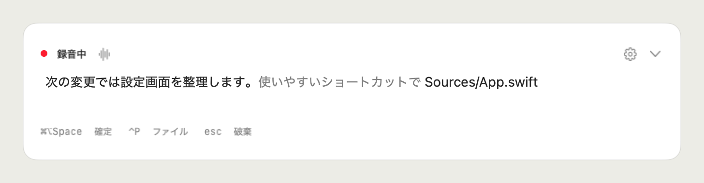
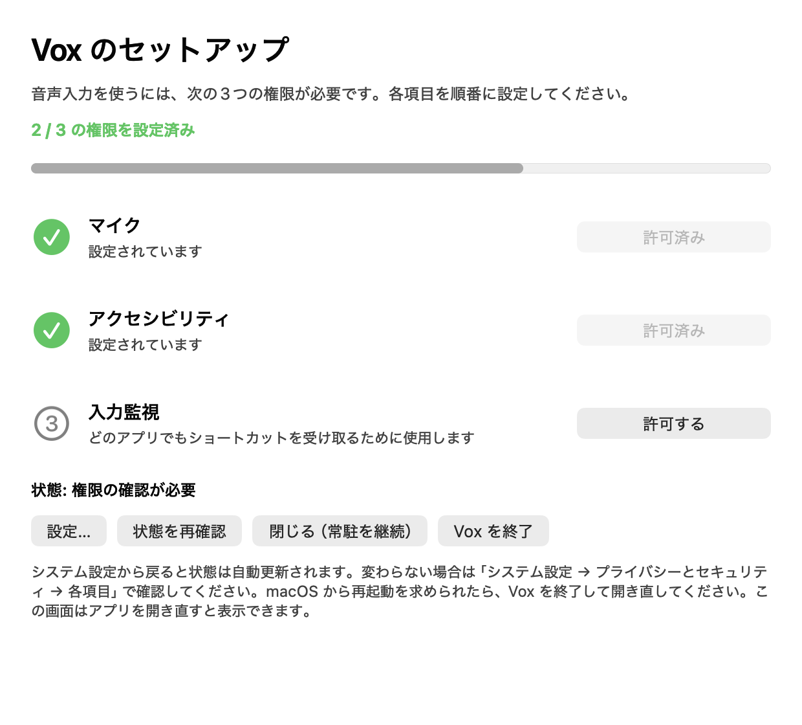
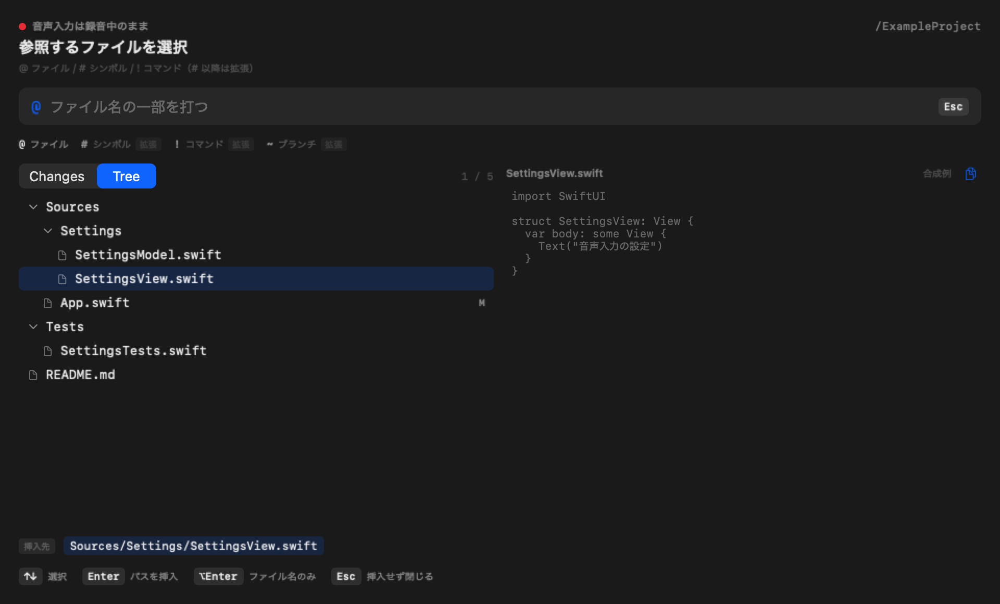
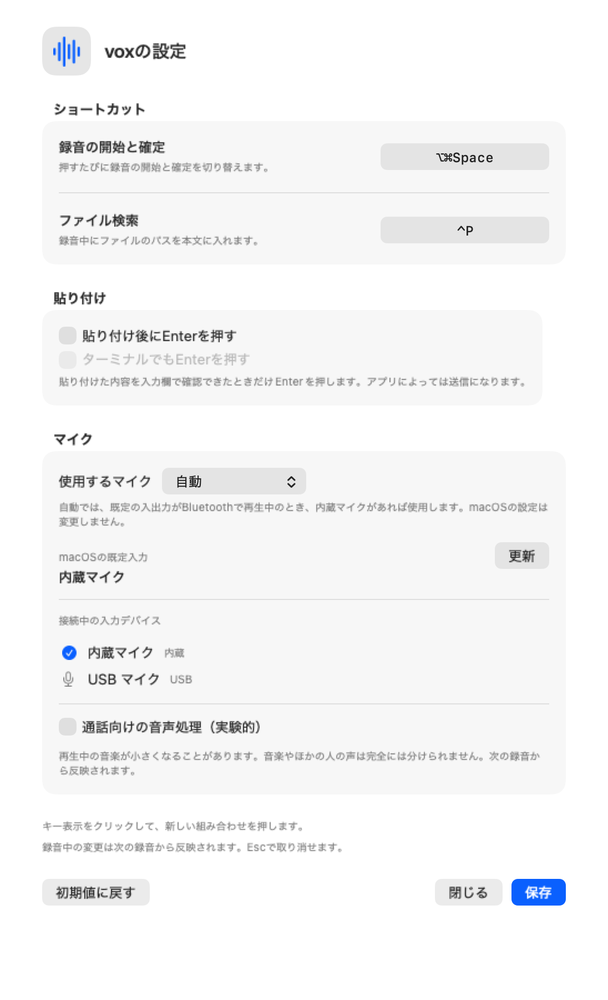

<p align="center">
  
</p>

# vox

[](https://github.com/MizuRyu/vox/releases)
[](LICENSE)

Speak, clean it up, paste it as is. A local Japanese voice-input HUD for macOS.

日本語版: [README.md](README.md)

[](images/vox-demo-en.mp4)

*Illustrative UI with synthetic data. Click to open the 25-second video with music. Japanese dictation and app labels are shown in Japanese.*

## Features

- **Real-time display** — what you say appears immediately in a HUD at the bottom of the screen; nothing reaches the target app until you commit
- **Type while you speak** — edit directly in the HUD. Typed text and new speech segments go at the caret, and recording never stops
- **File search while speaking (`⌃P` / `@`)** — resolves the target repository from the frontmost editor or terminal and inserts a path into the text; recording continues during the search
- **Commit in one paste** — press the recording key again to return to the app you started in and insert the whole committed text at once
- **Runs locally** — uses Haas Q4 by default, with Apple available in settings. Only the first model download needs the network. Nothing sends your text to the cloud
- **Filler removal** — rule-based removal of Japanese fillers before insertion; the raw text stays in the local history
- **Optional auto-Enter** — sends Enter after pasting once the input field reads back as expected; a single setting decides whether it also sends where the field cannot be read



*A HUD mock-up built from synthetic sentences and fictional paths. No real speech or third-party app screen is used.*

## Requirements

macOS 26 or later on Apple Silicon.

| What | Used for |
|---|---|
| Microphone permission | Recording |
| Accessibility permission | Pasting into the original app. Without it, Vox only copies to the clipboard |
| Input Monitoring permission | The recording shortcut. Without it, recording starts only from the menu bar |
| Internet connection (first run only) | Downloading the speech model |

## Speech recognition model

Vox defaults to Haas-ja-v1.0 Q4. Select Haas or Apple SpeechTranscriber (ja-JP) under speech recognition in settings; changes apply to the next recording.

| Item | Detail |
|---|---|
| Where it runs | On device. Haas uses a local worker process; Apple is managed by the OS |
| First run | Haas downloads and verifies its runtime and approximately 352MB Q4 weights. Apple downloads its Japanese model through the OS. Recognition then works offline |
| Partial results | Haas re-recognizes every 500ms; Apple uses `.fastResults` for updates roughly once a second |
| Network | Neither audio nor text leaves the machine |

Why this engine was chosen, and the candidates compared (Parakeet, Whisper variants), are in [docs/specs/02-speech-engines.md](docs/specs/02-speech-engines.md) (Japanese).

## Installation

One-line install or update (fetches the latest Release, copies it into `/Applications`, and removes the quarantine attribute):

```sh
curl -fsSL https://raw.githubusercontent.com/MizuRyu/vox/main/scripts/install.sh | bash
```

To install manually, download the `.dmg` from [Releases](https://github.com/MizuRyu/vox/releases), move `Vox.app` into `/Applications`, and remove the quarantine attribute (needed once because the build is not Developer ID signed or notarized):

```sh
xattr -dr com.apple.quarantine /Applications/Vox.app
```

On first launch the setup screen asks for Microphone, Accessibility, and Input Monitoring in order. If a grant is not reflected, press "状態を再確認" (re-check status); if macOS asks for a restart, quit Vox and open it again.



*A display example with two of three permissions granted. The actual state is checked at launch.*

To build from source, `just install` places the app in `/Applications/Vox.app` (see [docs/development.md](docs/development.md), Japanese).

## Usage

1. Put the caret in the field you want to paste into and press `⌘⇧Space`.
2. Speak, and watch the text in the HUD. Type into it directly, or insert a path with the file search.
3. Press `⌘⇧Space` again to commit and paste into the original app.

| Key | Action |
|---|---|
| `⌘⇧Space` | Start recording / commit and paste |
| `⌃P`, or type `@` in the HUD | File search |
| `Enter` in the palette | Insert the path. Expands/collapses folder rows; switches the search target on worktree rows |
| `Esc` | Close the palette; discard the text on the recording screen |
| `⌘,` | Open settings while Vox is focused |

The file search toggles between `Changes` and `Tree`. Changes lists modified files first; Tree shows the indexed files as a hierarchy.



*The real view rendered with fictional file names and contents.*

| When | Do this |
|---|---|
| A word is often misrecognized | Add the recognized form and the form you want under 辞書 (Dictionary) in settings |
| Paste or the shortcut stops working after an update | [Grant the permissions again](docs/usage.md#更新後に権限が効かなくなったとき) (Japanese) |
| You want another app to start recording | Turn on 連携 (Integration) in settings ([details](docs/usage.md#ほかのアプリから録音を操作する), Japanese) |

Full details on operation, permissions, and limitations are in [docs/usage.md](docs/usage.md) (Japanese).

## Settings



*The app's own settings view, rendered offscreen with synthetic settings and fictional microphone data.*

Open settings from the menu bar item, the gear in the HUD, or `⌘,`. You can change the recording and file-search shortcuts, enable auto-Enter and whether it also sends in terminals, choose whether the committed text stays on the clipboard (on by default), turn on the experimental voice processing, save recordings for debugging (off by default), and review the available microphones. See [docs/usage.md](docs/usage.md#設定) for what each item does.

## Limitations

- Vox does not summarize or rephrase. It only removes fillers, adds question marks and punctuation, and applies dictionary replacements, all by fixed rules.
- It does not fix every misrecognition. When the target is Orca, Zed, or a terminal, Haas gets up to 12 terms from the latest Claude / Codex conversation in the same folder as hints; Apple recognition cannot take vocabulary hints.
- The build is not Developer ID signed or notarized, so the quarantine attribute must be removed once.

## Development

```sh
nix develop
just setup
just build
just test
just verify
```

See [docs/development.md](docs/development.md) for setup, checks, and distribution, and [docs/README.md](docs/README.md) for specifications and technical decisions (both Japanese).

## License

[MIT](LICENSE)

The full license text for FluidAudio (Apache-2.0), which only the benchmark targets depend on, is in [THIRD-PARTY-LICENSES.md](THIRD-PARTY-LICENSES.md). It is not part of the app.
