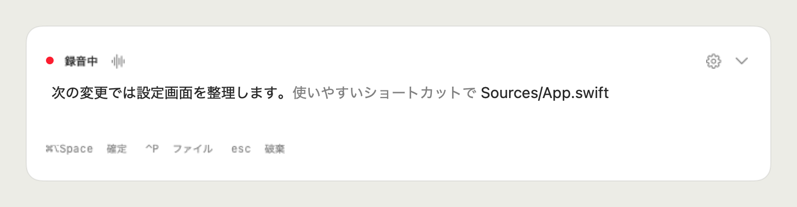
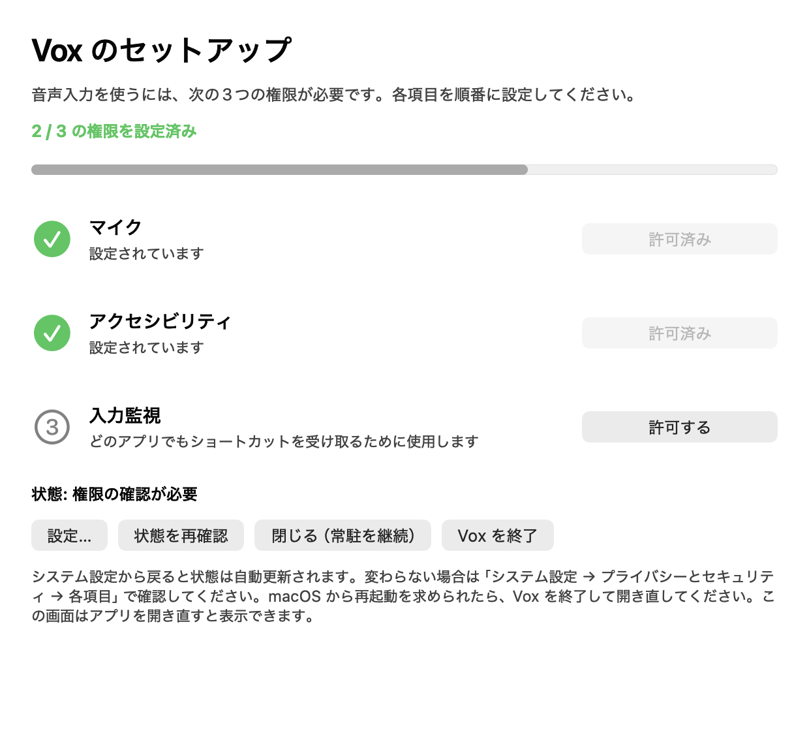
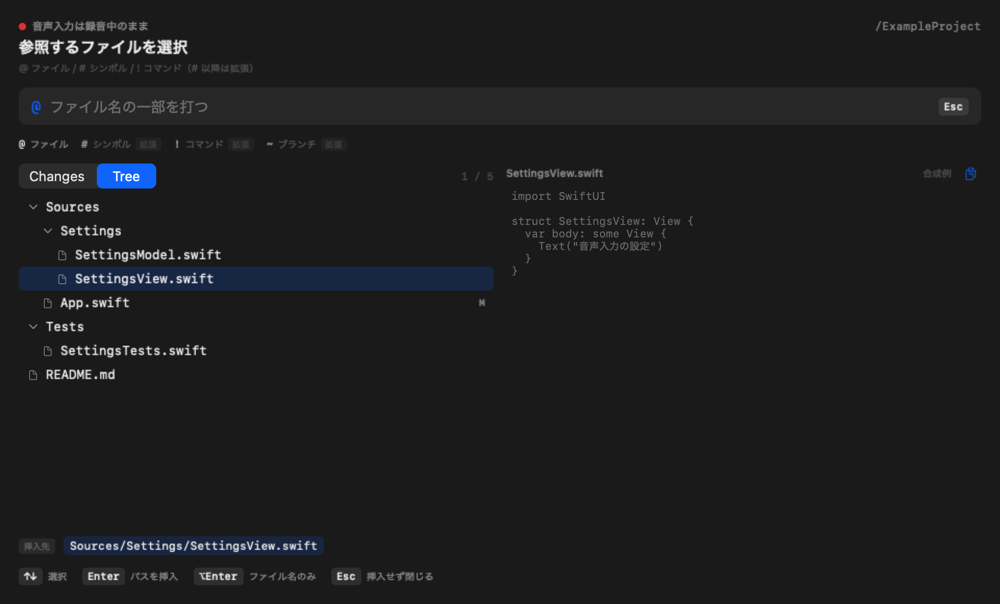
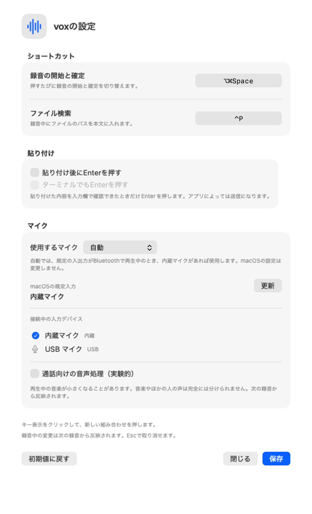

<p align="center">
  
</p>

# vox

[](https://github.com/MizuRyu/vox/releases)
[](LICENSE)

vox は、Mac 用の日本語音声入力アプリです。

話した内容を画面下の入力欄（HUD）で確認・編集し、元のアプリへ貼り付けます。音声認識は端末内で行い、音声や本文を外部へ送りません。

English version: [README.en.md](README.en.md)

[](images/vox-demo-ja.mp4)

*入力の流れを紹介する25秒の動画です。クリックすると音楽付きで再生します。画面は合成データで作成しており、実機録画ではありません。*

## できること

- **録音中の文章を編集する。** 話した内容が HUD に順次表示されます。手入力と新しい音声はカーソル位置に入り、編集している間も録音は続きます。確定するまで元のアプリには入力されません。
- **ファイルパスを入れる。** `⌃P` か `@` でファイルを検索し、選んだパスを本文に挿入できます。検索対象は使用中のエディタやターミナルから判定します。検索中も録音は続きます。
- **貼り付ける文章を整える。** 「えっと」「あの」などのフィラーを規則で除去します。よく誤認識する語は、辞書に「認識される表記」と「入れたい表記」を登録して置き換えられます。整形前のテキストは履歴に残ります。



*合成文と架空のパスで作った画面例です。実際の発話や他のアプリの画面は使っていません。*

## インストール

macOS 26 以降の Apple Silicon Mac で使えます。初回の音声モデル取得にはインターネット接続が必要です。

次のコマンドで最新版を取得し、`/Applications` に配置します。起動に必要な quarantine 属性の解除も行います。更新も同じコマンドです。更新前に Vox を終了してください。

```sh
curl -fsSL https://raw.githubusercontent.com/MizuRyu/vox/main/scripts/install.sh | bash
```

手動で入れる場合は [Releases](https://github.com/MizuRyu/vox/releases) から `.dmg` をダウンロードし、`Vox.app` を `/Applications` に置きます。Developer ID 署名・公証はしていないため、初回は次のコマンドで quarantine 属性を解除してください。

```sh
xattr -dr com.apple.quarantine /Applications/Vox.app
```

初回起動時に開くセットアップ画面で、マイク・アクセシビリティ・入力監視を順に許可します。反映されないときは「状態を再確認」を押してください。macOS が再起動を求めた場合は Vox を終了して開き直します。



*3 つの権限のうち、2 つを許可した状態の表示例です。実際の状態は起動時に確認します。*

ソースからビルドする場合は `just install` で `/Applications/Vox.app` に配置できます。手順は [開発手順](docs/development.md) を参照してください。

## 使い方

1. 貼り付けたい入力欄にカーソルを置き、`⌘⇧Space` を押します。
2. HUD に表示される文章を確認します。必要なら手入力で修正したり、ファイル検索でパスを挿入したりできます。
3. `⌘⇧Space` をもう一度押すと、文章を確定して元のアプリへまとめて貼り付けます。

| キー | 操作 |
|---|---|
| `⌘⇧Space` | 録音開始／確定して貼り付け |
| `⌃P` または HUD に `@` を入力 | ファイル検索 |
| ファイル検索で `Enter` | パスを本文へ挿入。フォルダ行では展開／折り畳み、worktree 候補では検索対象を切り替え |
| `Esc` | ファイル検索を閉じる。録音画面では本文を破棄 |
| `⌘,` | Vox にフォーカスがあるとき、設定を開く |

ファイル検索の `Changes` は変更されたファイルを優先して表示し、`Tree` は索引済みのファイルをフォルダごとに表示します。



*ファイル名と本文は架空のものです。*

操作、権限、制約の詳細は [使い方](docs/usage.md) にあります。

## 設定



*本体の設定画面を、合成した設定と架空のマイク情報で描画した例です。録音キーは変更例です。*

メニューバーの「設定…」、HUD の歯車、Vox にフォーカスがあるときの `⌘,` から開きます。

| 設定できること | 内容 |
|---|---|
| ショートカット | 録音開始・確定、ファイル検索に使うキー |
| 辞書 | 誤認識する表記と、置き換えたい表記の追加・編集 |
| 貼り付け | 確定本文をクリップボードに残すか（既定はオン）、貼り付け後に Enter を押すか |
| マイク | 使用するマイク、通話向けの音声処理（実験的） |
| 連携 | ほかのアプリから録音を操作できるようにするか |
| デバッグ | 録音を保存するか（既定はオフ） |

貼り付け後の Enter は、入力欄を読み返して本文と一致することを確認してから押します。入力欄を読み返せないアプリで押すかどうかは、別に設定できます。

マイクは「自動」が既定です。macOS の既定の入力・出力が両方 Bluetooth 系で、出力が使用中の場合は、内蔵マイクがあればそちらを使います。「macOSの既定」や個別のマイクも選べます。macOS 全体の設定は変えません。

各項目の詳しい説明は [使い方](docs/usage.md#設定) にあります。

## 音声認識

既定は Haas-ja-v1.0 の Q4 版です。設定画面の「音声認識」で Apple `SpeechTranscriber`（ja-JP）に切り替えられます。変更は次の録音から反映します。

<details>
<summary>認識モデルの詳細</summary>

| 項目 | 内容 |
|---|---|
| 実行場所 | 端末内。Haas は子プロセスで動き、Apple は OS が管理 |
| 初回の取得 | Haas は実行ファイルと約352MBの認識モデルを取得・検証。Apple は OS が日本語モデルを取得。以後の認識はネットワーク不要 |
| 途中結果の更新 | Haas は500ms間隔で再認識。Apple は `.fastResults` で約1秒周期の更新 |
| 外部への送信 | 音声も本文も送信しない |

Haas を選んだ理由は [ADR-032](docs/adr/032-switchable-haas-and-apple.md)、比較した候補（Parakeet、Whisper 系）は [音声認識モデルの仕様](docs/specs/02-speech-engines.md) を参照してください。

</details>

## 開発

```sh
nix develop
just setup
just build
just test
just verify
```

ビルド・検査・配布は [開発手順](docs/development.md)、仕様と技術判断は [ドキュメント一覧](docs/README.md) を参照してください。

## License

[MIT](LICENSE)

ベンチマークで使う FluidAudio（Apache-2.0）のライセンス原文は [THIRD-PARTY-LICENSES.md](THIRD-PARTY-LICENSES.md) に収録しています。FluidAudio はアプリ本体には含まれません。
